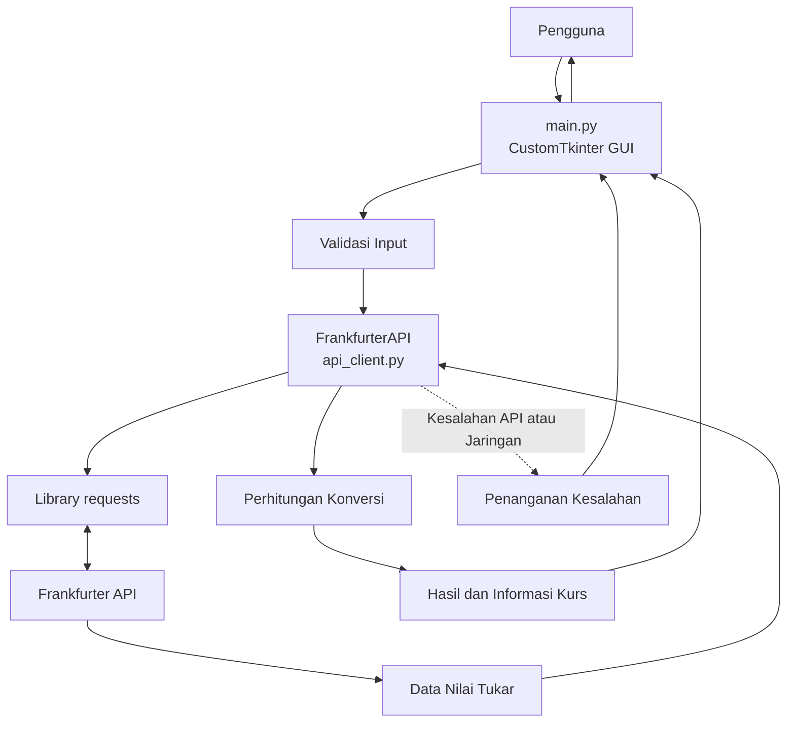

# MoneyConvert — Dokumentasi Arsitektur Sistem

## 1. Gambaran Umum

MoneyConvert adalah aplikasi desktop untuk konversi mata uang yang dikembangkan menggunakan Python dan CustomTkinter. Aplikasi ini memungkinkan pengguna memasukkan nominal uang, memilih mata uang asal dan tujuan, mengambil nilai tukar melalui Frankfurter API, serta melihat hasil konversi melalui antarmuka grafis.

Aplikasi menggunakan pendekatan modular dengan memisahkan antarmuka pengguna, komunikasi API, dan logika konversi. Pemisahan ini bertujuan meningkatkan keterbacaan kode, kemudahan pemeliharaan, dan kemampuan pengujian.

## 2. Teknologi yang Digunakan

| Teknologi | Fungsi |
|---|---|
| Python | Bahasa pemrograman utama |
| CustomTkinter | Membangun antarmuka grafis aplikasi desktop |
| Requests | Mengirim permintaan HTTP ke Frankfurter API |
| Frankfurter API | Menyediakan data nilai tukar mata uang |
| Git dan GitHub | Pengelolaan versi dan penyimpanan kode sumber |

## 3. Struktur Proyek

```text
convertet-money/
├── docs/
│   ├── architecture.md
│   └── test-plan.md
├── src/
│   ├── __init__.py
│   ├── api_client.py
│   └── converter.py
├── .gitignore
├── main.py
├── requirements.txt
└── README.md
```

### Fungsi Setiap Komponen

| File atau Direktori | Tanggung Jawab |
|---|---|
| `main.py` | Menjalankan aplikasi desktop dan mengelola antarmuka grafis |
| `src/api_client.py` | Mengambil data nilai tukar dari Frankfurter API |
| `src/converter.py` | Menyediakan logika perhitungan konversi mata uang |
| `src/__init__.py` | Menandai direktori `src` sebagai package Python |
| `docs/architecture.md` | Mendokumentasikan arsitektur sistem |
| `docs/test-plan.md` | Mendokumentasikan rencana pengujian |
| `requirements.txt` | Mencatat dependency eksternal aplikasi |
| `README.md` | Menjelaskan proyek dan cara menjalankan aplikasi |
| `.gitignore` | Mengecualikan file tertentu dari Git |

## 4. Arsitektur Komponen

### 4.1. Antarmuka Grafis — `main.py`

`main.py` merupakan titik masuk aplikasi sekaligus komponen yang mengelola interaksi pengguna.

Antarmuka dibangun menggunakan CustomTkinter dan mencakup jendela utama, kartu konversi, kolom nominal, pilihan mata uang, informasi nilai tukar, hasil konversi, serta tombol konversi.

Tanggung jawab:

- Menginisialisasi dan menjalankan jendela aplikasi.
- Mengatur tema, warna, ukuran, dan tata letak.
- Menerima input nominal dari pengguna.
- Menyediakan pilihan mata uang asal dan tujuan.
- Memvalidasi nominal sebelum melakukan konversi.
- Memanggil klien API untuk memperoleh nilai tukar.
- Menampilkan hasil konversi dan informasi kurs.
- Menampilkan pesan ketika input tidak valid atau permintaan API gagal.

Pada implementasi saat ini, proses konversi dipicu melalui fungsi `get_amount()` yang terhubung dengan tombol konversi.

### 4.2. Klien API — `src/api_client.py`

Komponen ini bertanggung jawab menangani komunikasi antara aplikasi dan Frankfurter API.

Kelas yang digunakan adalah `FrankfurterAPI`, dengan alamat dasar:

`https://api.frankfurter.dev/v2`

Tanggung jawab:

- Mengirim permintaan HTTP menggunakan `requests`.
- Mengatur batas waktu permintaan selama 10 detik.
- Memeriksa status respons HTTP.
- Membaca respons dalam format JSON.
- Mengambil nilai tukar berdasarkan mata uang asal dan tujuan.
- Mengambil data daftar mata uang yang tersedia dari API.

Metode yang tersedia:

| Metode | Fungsi |
|---|---|
| `__init__()` | Mengatur alamat dasar API |
| `get_rate(base, quote)` | Mengambil nilai tukar antara dua mata uang |
| `get_currencies()` | Mengambil daftar mata uang dari API |

Komponen ini tidak bertanggung jawab atas tampilan aplikasi maupun perhitungan nominal akhir.

### 4.3. Mesin Konversi — `src/converter.py`

Komponen ini menyediakan logika bisnis untuk menghitung hasil konversi mata uang.

Kelas yang digunakan adalah `CurrencyConverter`.

Tanggung jawab:

- Menerima objek API melalui constructor.
- Meminta nilai tukar melalui objek API tersebut.
- Menghitung hasil konversi berdasarkan nominal dan nilai tukar.
- Mengembalikan hasil perhitungan kepada pemanggil.

Rumus konversi:

```text
Hasil Konversi = Nominal Uang × Nilai Tukar
```

Metode yang tersedia:

| Metode | Fungsi |
|---|---|
| `__init__(api)` | Menyimpan objek API yang digunakan |
| `convert(amount, base, quote)` | Mengambil kurs dan menghitung hasil konversi |

**Kondisi implementasi:** kelas `CurrencyConverter` sudah tersedia dalam proyek, tetapi `main.py` yang didokumentasikan saat ini belum menggunakannya. Perhitungan masih dilakukan langsung dalam fungsi `get_amount()`.

## 5. Diagram Arsitektur Aplikasi

Diagram berikut menggambarkan alur kerja yang sesuai dengan kode `main.py` saat ini.



### Alur Kerja

1. Pengguna menjalankan aplikasi MoneyConvert.
2. Aplikasi menampilkan antarmuka grafis menggunakan CustomTkinter.
3. Pengguna memasukkan nominal dan memilih mata uang asal serta tujuan.
4. Pengguna menekan tombol konversi.
5. Fungsi `get_amount()` memvalidasi nominal.
6. `main.py` memanggil `FrankfurterAPI.get_rate()` untuk mengambil kurs.
7. Klien API mengirim permintaan ke Frankfurter API.
8. Nilai tukar diterima dan dikembalikan kepada `main.py`.
9. Aplikasi menghitung hasil konversi menggunakan nominal dikalikan nilai tukar.
10. Hasil dan informasi kurs ditampilkan pada antarmuka.
11. Jika terjadi kesalahan, aplikasi menampilkan pesan yang sesuai.

## 6. Pengelolaan Dependency

Dependency eksternal aplikasi dicatat dalam `requirements.txt`:

```text
customtkinter
requests
```

Instalasi dependency dilakukan menggunakan perintah:

```bash
pip install -r requirements.txt
```

Modul `src.api_client` dan `src.converter` merupakan kode internal proyek sehingga tidak perlu diinstal sebagai library terpisah.

## 7. Prinsip Arsitektur

### Pemisahan Tanggung Jawab

Antarmuka grafis, komunikasi API, dan logika konversi memiliki tanggung jawab masing-masing.

### Modularitas

Komponen ditempatkan dalam modul terpisah agar kode lebih mudah dibaca dan dikembangkan.

### Kemudahan Pengujian

Klien API dan mesin konversi dapat diuji secara terpisah dengan input yang terkontrol.

### Kemudahan Pemeliharaan

Perubahan pada tampilan atau mekanisme pengambilan nilai tukar dapat dikelola tanpa harus mengubah seluruh struktur aplikasi.

### Kesederhanaan

Arsitektur disesuaikan dengan skala aplikasi tanpa menambahkan lapisan yang belum dibutuhkan.

## 8. Keterbatasan Implementasi Saat Ini

- Pilihan mata uang pada antarmuka masih menggunakan daftar statis.
- Perhitungan dilakukan langsung di `main.py`, sehingga `CurrencyConverter` belum terintegrasi.
- Perhitungan masih menggunakan tipe data `float`.
- Penanganan kesalahan masih menggunakan exception handler yang luas.
- Daftar mata uang dari `get_currencies()` belum digunakan untuk mengisi pilihan pada antarmuka.

## 9. Pengembangan Selanjutnya

- Mengintegrasikan `CurrencyConverter` dengan antarmuka grafis.
- Mempertimbangkan penggunaan `Decimal` untuk perhitungan uang.
- Menghubungkan daftar mata uang dari API ke pilihan mata uang pada aplikasi.
- Memperbaiki penanganan kesalahan jaringan dan respons API.
- Menambahkan pengujian otomatis untuk perhitungan dan komunikasi API.

## 10. Kesimpulan

MoneyConvert merupakan aplikasi desktop berbasis Python yang menggunakan CustomTkinter untuk antarmuka grafis dan Frankfurter API untuk memperoleh nilai tukar mata uang.

Arsitektur modular yang digunakan menjadi dasar untuk mengembangkan aplikasi agar lebih mudah dipelihara, diuji, dan diperluas sesuai kebutuhan.
